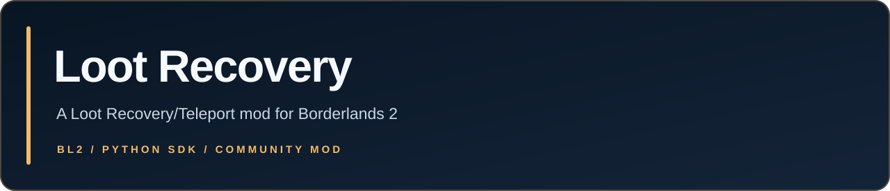

  <a href="#features">Features</a> ·
  <a href="#installation">Installation</a> ·
  <a href="#usage">Usage</a> ·
  <a href="#compatibility">Compatibility</a> ·
  <a href="#documentation">Documentation</a>

---

## Features

- Brings eligible, already-spawned loot from across the current map near your character, without creating or duplicating items.
- Filters equipment and resources by category, with optional gear rarity and opened-container gear settings.
- Gathers on demand with a rebindable shortcut (default **Enter**), waiting until you land if needed.
- Works in solo play or for the co-op host; items must still be picked up normally.

## Installation

1. Install [PythonSDK and Willow2 Mod Manager](https://bl-sdk.github.io/willow2-mod-db/).
2. Close Borderlands 2 and back up your existing `sdk_mods/LootRecovery/` folder and saved SDK settings.
3. When a **Player ZIP** is published, extract its `LootRecovery/` folder into `Borderlands 2/sdk_mods/`. Remove duplicate installations.
4. Confirm `sdk_mods/LootRecovery/__init__.py`, then launch the game and enable **Loot Recovery** in the SDK Mods menu.

**Availability:** No public Player ZIP has been published yet. GitHub's automatic source ZIP is not an installable Player package.

See the [user guide](docs/USER_GUIDE.md#install-update-or-rollback) for updates, rollback, and troubleshooting.

## Usage

Press **Gather All Loot** (default **Enter**) to move eligible world loot near your character. Configure pickup categories, rarity, and the shortcut in the SDK Mods menu. Gathering does not automatically collect items.

**Safety:** Avoid gathering during slot-machine payouts or scripted rewards, even with **Include Container Gear** Off. Loot placement is not guaranteed to clear obstacles or safe ground, so avoid cliffs, voids, and tight spaces with valuable items. [Safety and limitations](docs/USER_GUIDE.md#safety-and-limitations).

## Compatibility

**Windows Borderlands 2**, solo or hosting, is the primary Player target. Joining guests cannot initiate Gather; co-op replication is unverified. The Pre-Sequel is experimental, Proton/Wine is unverified, and native Linux BL2 is unsupported by this package. [Compatibility details](docs/USER_GUIDE.md#compatibility).

## Documentation

[User guide](docs/USER_GUIDE.md) · [Troubleshooting](docs/USER_GUIDE.md#troubleshooting) · [Report an issue](https://github.com/PeytonBlakeslee/LootRecovery/issues) · [MIT license](LICENSE) · [Third-party notices](THIRD_PARTY_NOTICES.md)

---

Other Borderlands 2 mods

- [No Warp Tunnel](https://github.com/PeytonBlakeslee/NoWarpTunnel)
- [Auto Pickup](https://github.com/PeytonBlakeslee/AutoPickup)
- [Controller Manager](https://github.com/PeytonBlakeslee/ControllerManager)
- [Controller Deadzone Control](https://github.com/PeytonBlakeslee/ControllerDeadzone)
- [OmniMovement](https://github.com/PeytonBlakeslee/OmniMovement)

